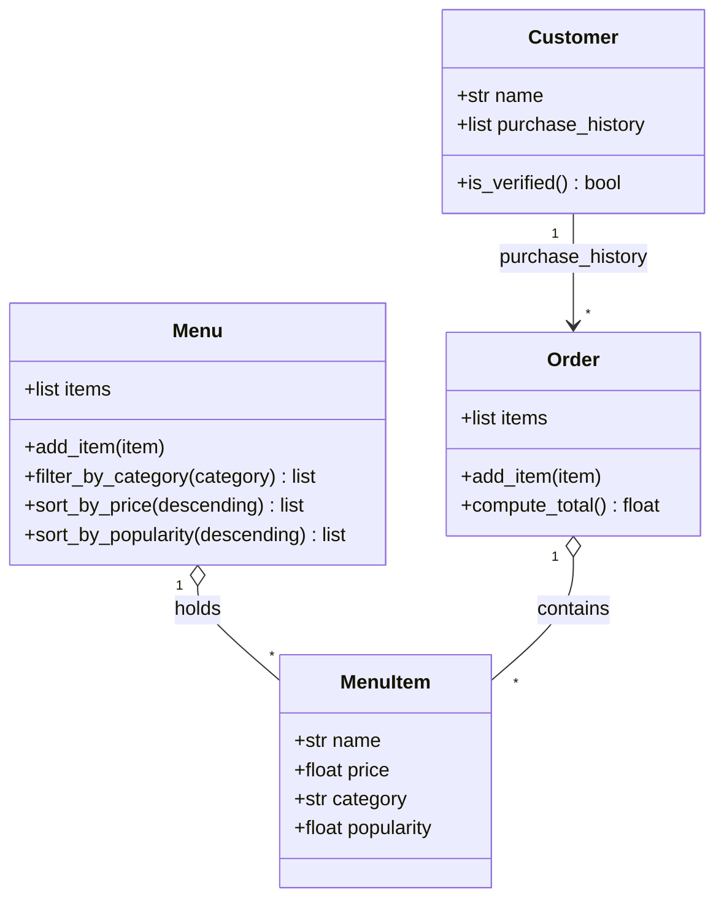

# ByteBites Design

## One-sentence summaries
- **Customer**: a named user whose past purchases let us verify they are real.
- **MenuItem**: one food item with name, price, category, popularity.
- **Menu**: the full collection of items, filterable by category and sortable.
- **Order**: one transaction grouping chosen items and computing the total.
