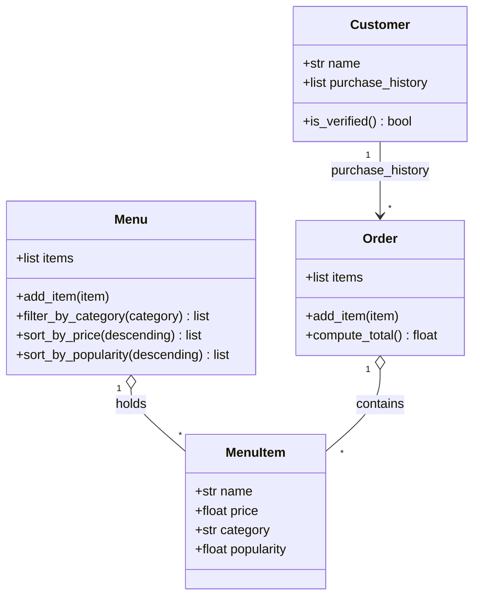

# ByteBites Final Design

**Assistant used:** Claude (claude.ai chat)
**Context given:** bytebites_spec.md + ByteBites_Design_Reference.md (with Behavioral Instructions filled in)

**Prompt used:**
> Using the attached spec and reference file, generate a minimal UML-style class
> diagram for Customer, MenuItem, Menu, and Order. Follow the reference rules.
> Include only spec attributes and the methods the spec requires.

## Diagram

## One-sentence summaries
- **Customer**: a named user whose past purchases let us verify they are real.
- **MenuItem**: one food item with name, price, category, popularity.
- **Menu**: the full collection of items, filterable by category and sortable.
- **Order**: one transaction grouping chosen items and computing the total.

## Iteration notes (verification against the spec)
1. First guided output matched the four classes and spec attributes.
2. Removed nothing extra this time, but double-checked each method against the spec:
   filter (spec), sort (Part 3 requirement), compute_total (spec),
   is_verified (spec: "verify they are real users"). add_item is needed to
   populate Menu and Order.
3. Kept Customer to Order as history only, since the spec just says "past purchase history."
