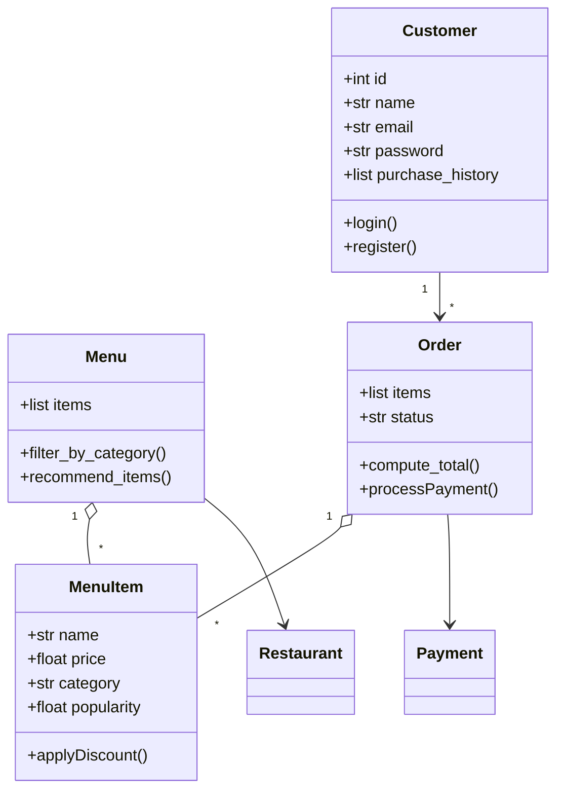

# Draft from standard chat (no reference file)

NOTE: Illustrative example of a typical unguided result. Replace with your own
assistant's real output before writing your checkpoint reflection.

Problems: adds Payment and Restaurant classes, plus email, password, id, status,
login, register, applyDiscount, recommend_items, processPayment. None are in the spec.
