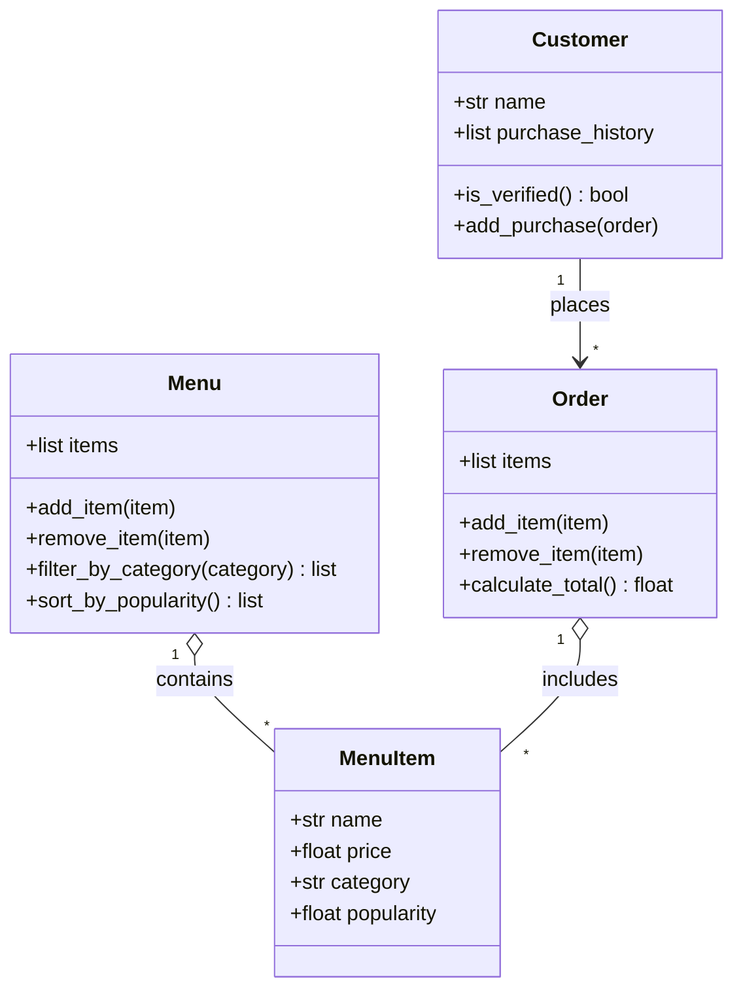

# Draft UML from standard chat (no reference file)

**Assistant used:** Claude (in claude.ai chat), not VS Code Copilot
**Context given:** bytebites_spec.md only. The reference file was NOT attached.

**Prompt used:**
> Here is my spec for ByteBites. I identified four classes: Customer, MenuItem,
> Menu, and Order. Please generate a UML-style class diagram for them.

## Output

## My review against the spec
- Same four classes as my candidate list, with no extra classes.
- Attributes match the spec.
- Unrequested additions: `add_purchase`, `remove_item` on Menu and Order.
  The spec only says to hold items, filter, and compute totals. Removing these
  in the final design.
- Missing: price sorting (spec lists filter by category; sorting comes from Part 3).
- Relationship "Customer places Order" is reasonable but the spec only says
  Customer tracks purchase history. Final design keeps it as history only.
